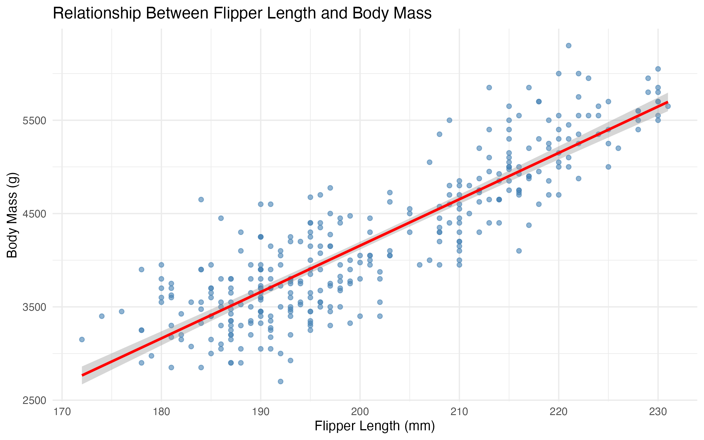
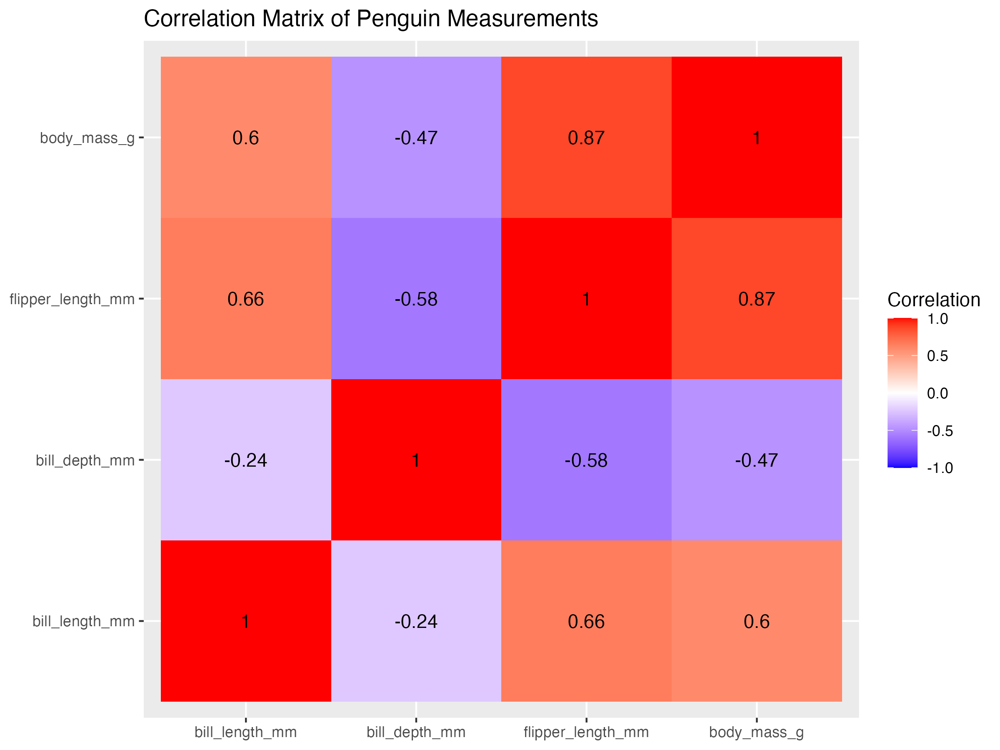

# Palmer Penguins Analysis and Modelling

An R project exploring the Palmer Penguins dataset through descriptive statistics, hypothesis testing, correlation analysis, linear regression, and visualisation. The analysis uses `palmerpenguins` for the dataset and `ggplot2` for charts.

## Dataset

The project uses the built-in `penguins` dataset from `palmerpenguins`, containing observations of Adelie, Chinstrap, and Gentoo penguins. Variables include species, island, bill length and depth, flipper length, body mass, sex, and year. No separate data download is required.

Missing values are handled separately for each analysis: summary statistics omit missing values, hypothesis tests filter the required variables, and correlation and regression use complete observations for their selected measurements.

## Analysis

The workflow in [`analysis.R`](analysis.R) covers:

1. **Data exploration:** inspect the dataset, count missing values, and calculate the mean, median, minimum, maximum, and standard deviation of numeric variables.
2. **Hypothesis testing:** use Welch's two-sample t-test to compare body mass between Adelie and Gentoo penguins, and a two-sided proportion test to assess whether the male proportion differs from 0.5. The stated significance level is 0.05.
3. **Correlation:** calculate Pearson correlations between bill length, bill depth, flipper length, and body mass, and display a heatmap.
4. **Regression:** predict body mass using flipper length alone, then using flipper length, bill length, and bill depth. Calculate adjusted R-squared and in-sample root mean squared error (RMSE) for each model.
5. **Visualisation:** create a scatter plot with a fitted regression line, a species boxplot, and a body-mass histogram with a fitted normal density curve.

The regression metrics describe fit to the data used to train the models; the script does not perform a train/test split or cross-validation.

## Getting started

Install R and, optionally, RStudio. The required R packages are:

```r
install.packages(c("palmerpenguins", "ggplot2"))
```

Open `peng-ana-deling.Rproj` in RStudio and run `analysis.R` interactively to inspect the statistics and model summaries. Alternatively, from the project directory, run:

```sh
Rscript analysis.R
```

**Note:** the script begins with `install.packages()` calls, so each execution attempts to install the dependencies and may require internet access and a configured CRAN mirror. After installing the packages once, you can comment out those two lines to skip repeated installation.

When using `source("analysis.R")` or `Rscript`, explicitly printed hypothesis tests and correlations appear in the console, but bare expressions such as `summary(simple_model)` may not display automatically. Run those expressions interactively or wrap them in `print()` to view their output.

## Generated charts

Running the script creates `plots/` if needed and writes the following PNG files at 300 DPI. Existing files with the same names are overwritten.

| File | Contents |
| --- | --- |
| `plots/scatter_plot.png` | Flipper length versus body mass, with a regression line and confidence band |
| `plots/box_plot.png` | Body-mass distribution by species |
| `plots/histogram_plot.png` | Body-mass density histogram with a normal curve |
| `plots/correlation_heatmap.png` | Correlations between the four physical measurements |

### Flipper length and body mass



### Correlation matrix



## Project structure

```text
.
├── analysis.R              # Analysis and chart exports
├── peng-ana-deling.Rproj   # RStudio project configuration
├── README.md
└── plots/                 # Generated PNG charts
```
